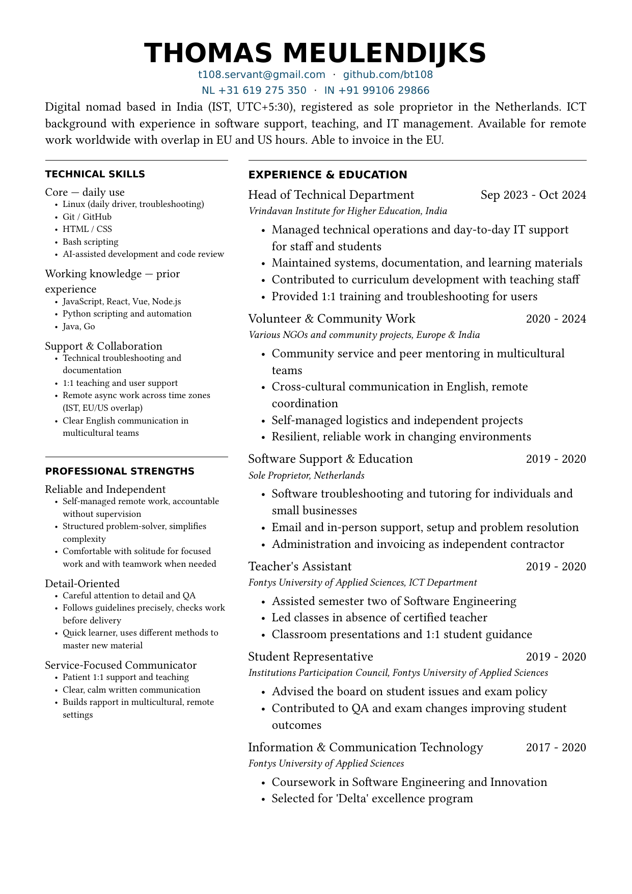

# CV

[](https://typst.app)

Content in `details.yml`, layout in a Typst template, output a one-page PDF —
for keeping a CV as version-controlled plain text.

## 30-second example

An entry in `details.yml`:

```yaml
timeline:
  heading: Experience & Education
  list:
    - time: Sep 2023 - Oct 2024
      vis: y
      heading: Head of Technical Department
      subtext: Vrindavan Institute for Higher Education, India
```

```sh
make          # typst compile main.typ → output.pdf (git-ignored)
make clean    # rm -f output.pdf
```

## Sample output

`output.pdf` at 150 dpi:



## Prerequisites

| Tool | Why |
|---|---|
| Typst (`typst`) | Compiles `main.typ` to PDF (`snap install typst --classic` or `cargo install typst-cli`) |
| DejaVu Sans font | Title + headings render in it; build fails without it |

## Commands

| Command | Effect |
|---|---|
| `make` | Default target: `typst compile main.typ → output.pdf` |
| `make clean` | `rm -f output.pdf` |

## Project layout

```
main.typ              # entrypoint: yaml("details.yml") -> cv(data)
template.typ          # layout only: cv(), section/entry helpers
details.yml           # content only (vis: y renders, else hidden)
makefile              # typst compile main.typ output.pdf
docs/img/preview.png  # README screenshot (rendered output.pdf)
output.pdf            # build output (git-ignored)
```

## Content model

- `details.yml` → contact, intro, skills, timeline, strengths + page settings.
- `main.typ` feeds it to `cv()` in `template.typ` (two-column grid).
- `vis: y` renders an entry; anything else hides it in-file.
- PDF is never hand-edited; rebuild via `make`.
